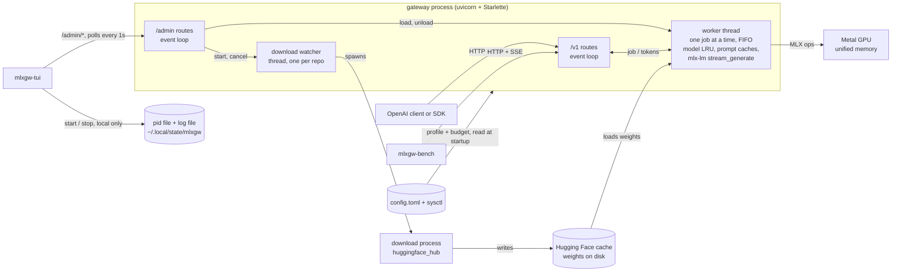

# Architecture

One process, one worker thread, MLX in the middle.

## The system

Request handlers never touch a model. They hand a job to the single worker thread,
which loads weights from the Hugging Face cache and runs generation.

## Why it is shaped this way

- **One worker thread.** MLX generation is not safe to run concurrently, and its
  generation stream is thread-local. Every MLX call (load, unload, generate) happens on
  one thread. The thread's FIFO queue is the request queue.
- **Event loop stays free.** Handlers bridge to the worker through an asyncio queue, so
  status and other requests are answered while a generation runs.
- **Downloads in a separate process.** A download never blocks generation, and
  cancelling it means terminating the child process. A watcher thread reports progress
  as bytes in the model's cache folder.
- **Detached gateway for the TUI.** The TUI starts the gateway in its own session and
  records it in a pid file, so quitting the TUI leaves the gateway running. Stop only
  signals a process that the pid file names and whose command line is an mlxgw
  server on that port.

## Module map

| Module | Lines | Responsibility |
|---|---:|---|
| `config.py` | 118 | Config file, env overrides, hardware detection, profile and budget |
| `api.py` | 274 | Request validation (including tools), OpenAI response, chunk and error shapes |
| `engine.py` | 546 | Worker thread, model LRU, prompt-cache store, stop matcher, tool-call splitter, generation |
| `server.py` | 202 | Starlette app, auth, streaming, disconnect handling, entry point |
| `admin.py` | 358 | Admin routes, request ring, log buffer, download manager |
| `control.py` | 232 | Admin client and local start/stop through the pid file (stdlib only) |
| `bench.py` | 355 | Benchmark command; starts its own gateway when none is running |
| `tui.py` | 583 | Textual app (optional extra, not a core dependency) |

MLX and mlx-lm are imported lazily, inside the functions that need them, so the rest
is testable without a model.

## Commands

| Command | Module | Purpose |
|---|---|---|
| `mlxgw` | `server.py` | Run the gateway |
| `mlxgw-bench` | `bench.py` | Measure tokens per second per alias |
| `mlxgw-tui` | `tui.py` | Manage a local or remote gateway |
